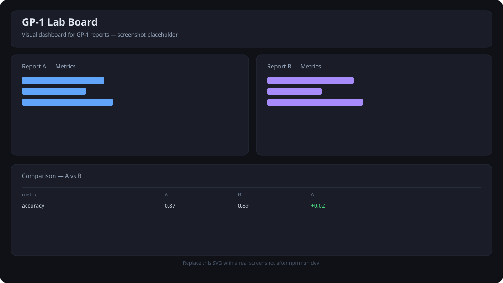

# GP-1 Lab Board

Visual dashboard for [GP-1](https://github.com/Gopyr/GP-1) JSON reports. Upload one or two report files, see metrics as bar charts, and compare runs side-by-side. All parsing happens in the browser.

> Companion to the main project **GP-1** (`Gopyr/GP-1`). This board does not replace GP-1 — it only visualizes its JSON output.

## Screenshot



*Replace `public/screenshot-placeholder.svg` with a real screenshot after first run.*

## Features

- File upload for 1–2 JSON reports (FileReader, no server)
- Auto-extracts numeric metrics from `metrics`, `results`, `summary`, or top-level numbers
- SVG bar charts (no heavy chart deps)
- Comparison table with Δ (B − A) for overlapping metrics
- Raw JSON inspector

## Run

```bash
npm install
npm run dev    # http://localhost:5173
npm run build
npm run preview
```

## Expected JSON

Any JSON with numeric values works. Ideal shape:

```json
{
  "summary": { "accuracy": 0.87, "loss": 0.32, "f1": 0.81 },
  "meta": { "model": "GP-1", "version": "0.1" }
}
```

Also supports `metrics: [{label, value}]` and `results` arrays.

## Notes

- No data leaves the browser. No tracking.
- Charts are simple SVG — intentionally dependency-free.
- If no numeric metrics are found, check that values are numbers (not strings).

## License

MIT
