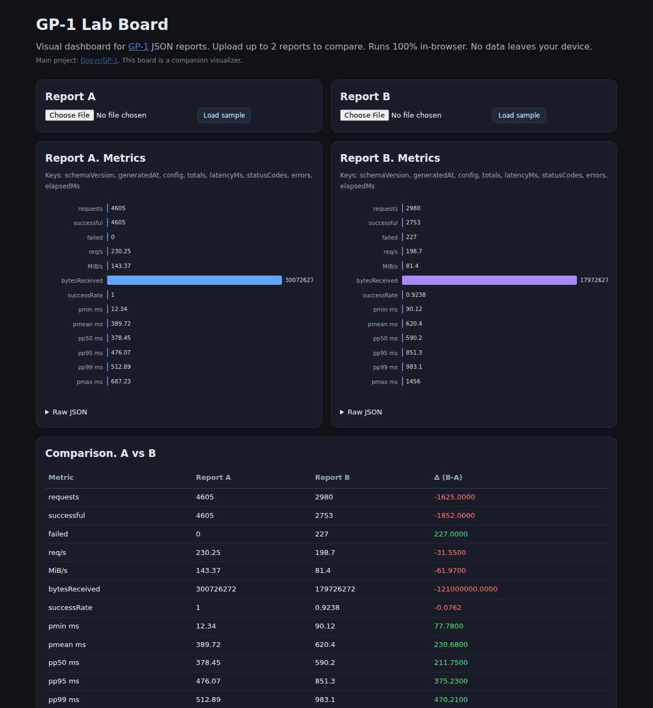

# GP-1 Lab Board

Visual dashboard for [GP-1](https://github.com/Gopyr/GP-1) JSON reports. Upload one or two report files, see metrics as bar charts, and compare runs side-by-side. All parsing happens in the browser; nothing leaves your device.

> Companion to the main project **GP-1** (`Gopyr/GP-1`). This board does not replace GP-1: it only visualizes its JSON output.

## Screenshot

The board auto-loads two real GP-1 reports on open (saturation run + fault profile) so it demos immediately without an upload:



## Features

- File upload for 1-2 JSON reports (FileReader, no server)
- Auto-extracts metrics from GP-1 `totals`/`latencyMs` plus `metrics`, `results`, `summary`, or top-level numbers
- Auto-loads real GP-1 sample reports on open
- SVG bar charts (no heavy chart deps)
- Comparison table with delta (B - A) for overlapping metrics
- Raw JSON inspector

## Run

```bash
npm install
npm run dev    # http://localhost:5173
npm run build
npm run preview
```

## Expected JSON

Any JSON with numeric values works. The board prefers a GP-1 style report (schemaVersion 2):

```json
{
  "config": { "url": "http://127.0.0.1:3000/hello", "concurrency": 400 },
  "totals": { "requests": 4605, "successful": 4605, "failed": 0, "requestsPerSecond": 230.25, "mebibytesPerSecond": 143.37 },
  "latencyMs": { "min": 12.34, "mean": 389.72, "p50": 378.45, "p95": 476.07, "p99": 512.89, "max": 687.23 }
}
```

Also supports `metrics: [{label, value}]`, `results` arrays, and `summary` objects.

## Notes

- No data leaves the browser. No tracking.
- Charts are simple SVG: intentionally dependency-free.
- If no numeric metrics are found, check that values are numbers (not strings).

## License

MIT
